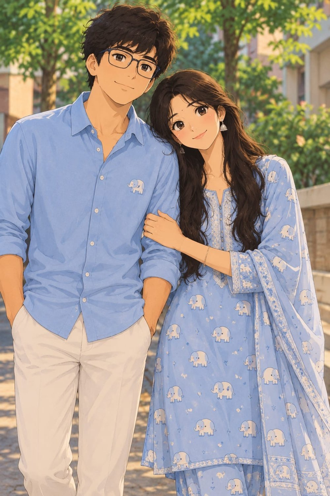

<!DOCTYPE html>
<html lang="en">
<head>
<meta charset="UTF-8">
<meta name="viewport" content="width=device-width, initial-scale=1">
<title>Happy Birthday, Nanaluu 🐘</title>
<link rel="preconnect" href="https://fonts.googleapis.com">
<link href="https://fonts.googleapis.com/css2?family=Fraunces:ital,wght@0,400;0,600;1,400&family=Caveat:wght@500;700&display=swap" rel="stylesheet">

</head>
<body>

<!-- 2. Opening -->
<section id="open" class="screen">
  

    
Today is all about you

    <h1>Happy Birthday, Nanaluu 🐘</h1>
    

    
🎂

    
Tap the cake and make a wish

    <button id="btn" class="hidden">Read what I wrote for you</button>
  

</section>

<!-- 3. Letter -->
<section id="letter">
  
It's been three months since we met, 
  and the moment I first saw you, something felt different moment of Flying colours to me ❤️

  
Little did I know that your smile would become one of my favourite things, 
  your care would mean so much to me, 
  and your concern would make me feel special in ways I can't explain.

  
From those little smiles to our silly conversations, 
  from your care to those adorable names — 
  my Dumbo, my Nanaluu 😍

  
Somehow, in just three months, 
  you've become a beautiful part of my everyday thoughts.

  
I don't know what the future has written for us, 
  but if I could choose one beautiful possibility, 
  it would be to see you beside me 🙈 
  not just for a few moments, 
  but through all the little and big moments life has waiting for us.

  
Maybe some feelings are too precious to say directly 😊 
  So, for now, I'll just say this…

  
I'm really glad our paths crossed. And if life ever gives me the choice,
  I'd love for our story to become something that lasts forever. ❤️✨

</section>

</body>
</html>
